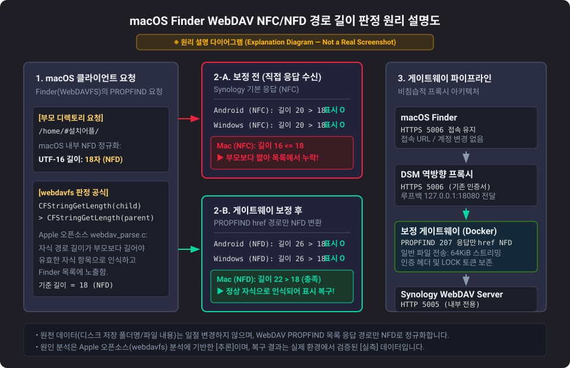
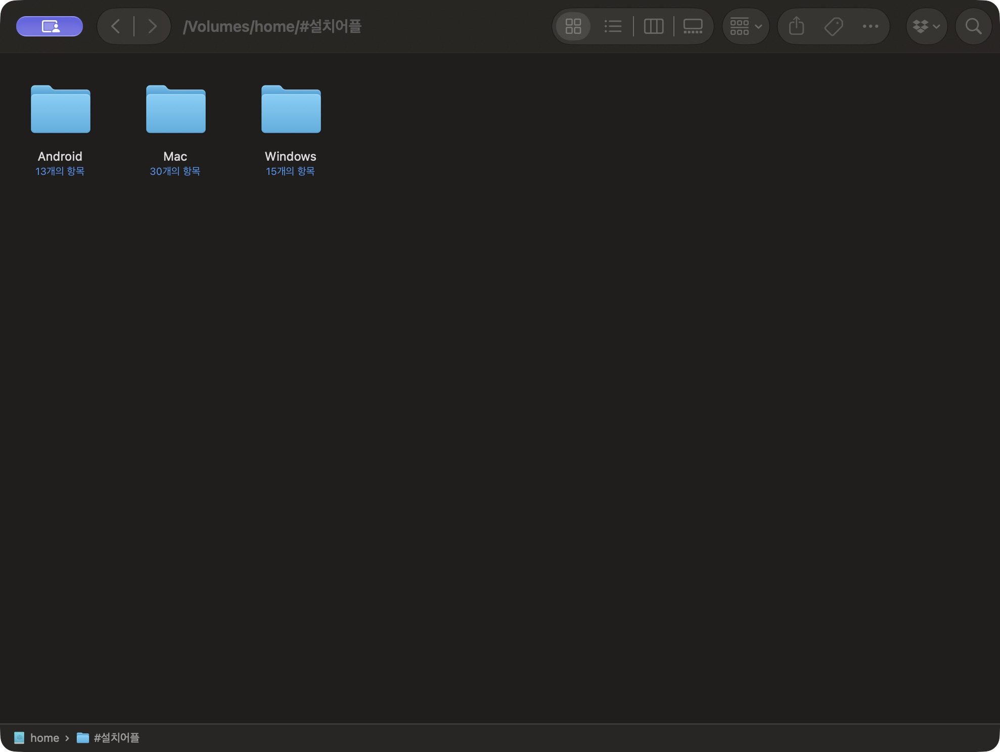
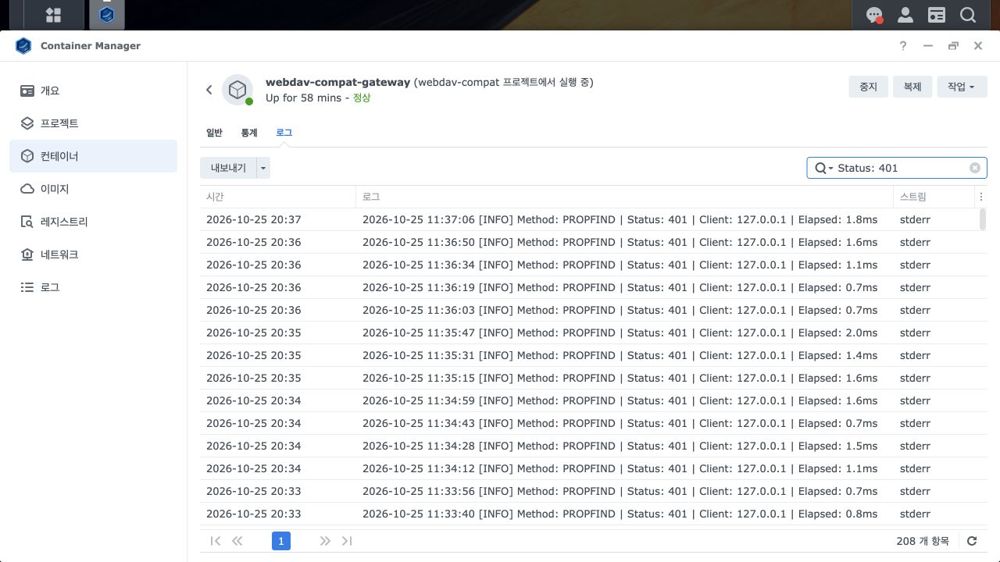

# 맥에서 Synology WebDAV 폴더가 사라질 때 — 이름과 접속 주소를 바꾸지 않고 해결하기

macOS Finder(WebDAVFS)의 유니코드(NFC / NFD) 경로 길이 판별 메커니즘으로 인해, 특정 조건(예: 한글이 포함된 상위 폴더 내의 짧은 영문 폴더명 `Mac`)에서 폴더가 Finder 목록에서 사라지는 문제를 해결하는 비침습적 WebDAV 호환 역방향 프록시 게이트웨이입니다.

- **GitHub 저장소**: [armsone/webdav-finder-compat](https://github.com/armsone/webdav-finder-compat)
- **웹사이트 가이드**: [Hanstree 기술 가이드](https://hanstree.com/guides/webdav-macos-folders)

---

## 1. 검증 및 정보 신뢰성 구분

본 문서와 저장소에 기술된 내용은 다음과 같이 검증 수준을 엄격히 구분하여 작성되었습니다.

- **[실측 (Measured)]**: Synology DS1821+ NAS 및 macOS 테스트 환경에서 관측된 로그, 현상 재현, 유니코드 UTF-16 경로 길이 계산을 통해 확인한 결과 (별도 패킷 캡처 증명은 아님).
- **[사용자 확인 (User-confirmed)]**: 실제 사용 환경에서 사용자가 직접 다른 문제 경로 폴더들의 복구 상태를 확인한 사항 (전체 홈 디렉토리 검사는 사용자 지시로 제외/중단됨).
- **[추론 (Inferred)]**: Apple 공개 오픈소스(`webdavfs`) 분석 및 재현 증상을 토대로 유추한 버그 메커니즘 (Apple의 공식 버그 확정이나 지원 약속 아님).
- **[미검증 (Unverified)]**: 대규모 외부 네트워크 벤치마크, Nginx 업로드 버퍼링 실측치, 비공개 최신 macOS 바이너리와의 100% 일치 여부 등.

---

## 2. 증상 및 재현 환경

### 증상 요약 [실측]
- 동일한 Synology 계정으로 DSM File Station이나 동일 Mac의 SMB(Finder)에서는 `Mac` 폴더가 정상적으로 보이고 파일 접근이 가능함.
- macOS 네이티브 Finder('서버에 연결', WebDAVFS)로 접속하면 다른 형제 폴더(`Android`, `Windows`)는 보이지만 `Mac` 폴더만 목록에서 완전히 누락됨.
- `Mac` 폴더의 이름을 긴 이름이나 한글 이름(예: `Macintosh` 또는 `맥`)으로 변경하면 Finder에 나타나고, 다시 `Mac`으로 변경하면 즉시 사라짐.
- 원본 저장 폴더명이나 디렉토리 구조를 변경하지 않고 해결해야 함.

### 테스트 및 검증 환경 [실측]
- **NAS 모델**: Synology DS1821+
- **DSM 운영체제**: DSM 7.4.1-90080
- **WebDAV Server 패키지**: 2.4.8-20135
- **macOS 버전**: macOS 27.0.1
- **Docker 버전**: Docker 24.0.2
- **런타임 / 패키지**: Python 3.11.17, aiohttp 3.14.5

---

## 3. 기술적 원인 분석

### Apple webdavfs 경로 판별 메커니즘 [추론]
Apple 오픈소스 distributions의 [webdavfs 소스 코드 (webdav_parse.c)](https://github.com/apple-oss-distributions/webdavfs/blob/a239d37d7407700119e9c92f66f38ab0a296cb0f/mount.tproj/webdav_parse.c#L1415-L1538)의 `GetNormalizedPathLength` 및 `GetComponentName` 함수를 분석한 결과:

1. Finder(WebDAVFS)는 서버에 PROPFIND 요청을 보낼 때 부모 경로를 **NFD(자모 분리)** 형태로 인코딩하여 전송합니다.
2. WebDAV 서버로부터 207 Multi-Status 응답을 받으면, URL Percent Decoding을 거친 후 `CFStringGetLength`를 호출하여 부모 경로 길이와 자식 항목 경로의 길이를 비교합니다.
3. 자식 항목의 경로 길이가 부모 경로 길이보다 길어야(`child_length > parent_length`) 유효한 하위 항목으로 인식합니다.
4. 그러나 Synology WebDAV Server는 항목 목록 응답을 표준 **NFC(완성형)** 형태로 반환합니다.
5. 부모 폴더에 한글이 포함된 경우 NFD 변환 시 글자 수(UTF-16 코드 유닛)가 크게 늘어나는 반면, 자식 폴더가 짧은 영문명(`Mac`)이면 NFC 형태의 자식 전체 경로 길이가 NFD 부모 경로 길이보다 길지 않게 되어 Finder가 이를 자식 항목에서 누락시킵니다.

### NFC / NFD UTF-16 경로 길이 비교표 [실측]

부모 디렉토리 경로: `/home/#설치어플/`

| 경로 항목 | 정규화 형태 | UTF-16 글자 수 | 부모 기준 길이(18)와 비교 | Finder 표시 결과 |
| :--- | :---: | :---: | :---: | :---: |
| 부모 요청 경로 (`#설치어플/`) | **NFD** (macOS 요청) | **18** | *(판정 기준)* | - |
| 부모 응답 경로 (`#설치어플/`) | **NFC** (서버 기본) | 12 | - | - |
| `Mac` 자식 경로 | **NFC** (보정 전 응답) | **16** | **16 <= 18 (부모보다 짧음)** | ❌ **누락 (사라짐)** |
| `Mac` 자식 경로 | **NFD** (게이트웨이 보정 후) | **22** | **22 > 18 (부모보다 긺)** | ✅ **정상 노출 (복구됨)** |
| `Android` 자식 경로 | **NFC** (서버 기본) | **20** | **20 > 18 (부모보다 긺)** | ✅ 정상 노출 |
| `Windows` 자식 경로 | **NFC** (서버 기본) | **20** | **20 > 18 (부모보다 긺)** | ✅ 정상 노출 |

### 원리 설명 다이어그램

아래 다이어그램은 macOS 클라이언트의 NFD 요청과 Synology의 NFC 응답 간 길이 불일치로 인한 누락 원인과 프록시의 보정 흐름을 설명합니다.



> **※ 안내**: 위 다이어그램은 동작 원리를 설명하기 위해 제작된 설명도(Explanation Diagram)이며, 실제 화면 캡처(스크린샷)가 아닙니다.

---

## 4. 해결 방법 및 아키텍처

### 비침습적 보정 원칙
- **디스크 원본 보존**: NAS 저장소의 실제 폴더명, 파일명, 파일 내용은 전혀 수정하지 않습니다.
- **선택적 NFD 변환**: 클라이언트의 입력 경로를 강제로 변환하지 않으며, 오직 `User-Agent`가 macOS WebDAVFS인 경우의 `PROPFIND 207 Multi-Status` 응답 XML 내 `DAV:multistatus/DAV:response/DAV:href` 경로만 NFD로 정규화합니다.
- **헤더 및 토큰 처리**: 인증 헤더 및 WebDAV LOCK 토큰, If 헤더, Destination 헤더는 그대로 보존하되, 경로가 보정된 207 Multi-Status 응답의 Content-Length는 재계산되며 ETag, Digest, Content-MD5 헤더는 제거됩니다 (모든 헤더가 무수정 통과된다고 주장하지 않음).
- **스트리밍 파이프라인**: 일반 파일 업로드 및 다운로드는 64KiB 청크 단위로 실시간 스트리밍하며, 디렉토리 목록 XML만 최대 10MiB 상한 내에서 버퍼링하여 파싱합니다.

### 시스템 흐름도
```
[ macOS Finder (WebDAVFS) ]
            │  HTTPS 5006 (기존 접속 주소 및 포트 유지)
            ▼
[ DSM 내장 역방향 프록시 ] (기존 SSL 인증서 종단)
            │  HTTP 127.0.0.1:18080 (로컬 격리 루프백)
            ▼
[ WebDAV 호환 게이트웨이 (Docker) ] (PROPFIND 207 href NFD 보정)
            │  HTTP host.docker.internal:5005
            ▼
[ Synology WebDAV Server ] (HTTP 5005 내부 청취, 실제 권한/인증 판정)
```

---

## 5. 실제 검증 결과 및 스크린샷

### 복구 검증 결과 [실측 및 사용자 확인]
- **부모 폴더 복구 [실측]**: 기존 URL(`https://nas.example.com:5006/home/#설치어플/`) 그대로 마운트 시 `Mac` 폴더가 즉시 표시되며 내부 항목 정상 읽기 확인.
- **하위 항목 목록 대조 [실측]**: `#설치어플` 하위 전체 161개 항목(폴더 36개, 파일 125개)에 대해 DSM 원본과 Finder 마운트의 디렉토리 목록 및 메타데이터 일치 확인 (누락 0, 추가 0, 정규화 충돌 0; 파일 내용 전체의 무결성 전수 검증은 아님).
- **추가 위치 확인 [사용자 확인]**: 사용자가 과거 동일 증상을 겪었던 다른 문제 경로 폴더들도 정상 노출됨을 확인.
- *(전체 홈 디렉토리 전수 검사는 사용자 요청에 따라 검사 대상에서 제외/중단함)*

### 실제 스크린샷

#### 1) 복구 후 Finder 실제 화면 [실제 스크린샷]
사이드바의 개인 계정 정보를 숨기고 실제 복구 상태를 촬영한 화면입니다. 누락되었던 `Mac` 폴더가 원래 이름 그대로 정상 노출되는 것을 확인할 수 있습니다.



#### 2) 게이트웨이 기동 및 401 인증 로그 [실제 스크린샷]
Synology Container Manager에서 게이트웨이가 정상 구동되어 비인가 PROPFIND 요청에 대해 정상적으로 HTTP 401 Unauthorized를 반환하는 로그 화면입니다 (개인 식별 주소가 필터링된 실제 화면).



---

## 6. 설치 및 배포 가이드 (Synology GUI 단계별 안내)

기존 NAS 시스템 파일이나 Nginx 설정을 직접 건드리지 않고, Synology GUI(Container Manager 및 역방향 프록시)만을 사용하여 안전하게 구축합니다.

### 1단계: 프로젝트 환경 준비
1. NAS의 Docker 공유 폴더에 디렉토리를 생성합니다 (예: `/volume1/docker/webdav-finder-compat`).
2. 저장소의 파일들을 해당 디렉토리에 복사합니다.
3. 제공된 환경 설정 템플릿을 복사하여 `.env` 파일을 생성합니다.
   ```bash
   cp env.example .env
   ```
4. `.env` 파일을 열고 실제 외부에서 접속하는 HTTPS 스킴, 도메인, 포트와 정확히 일치하도록 `WEBDAV_PUBLIC_ORIGIN`을 필수로 설정합니다 (예: `WEBDAV_PUBLIC_ORIGIN=https://nas.example.com:5006`). 이 값이 실제 외부 접속 주소와 불일치하면 COPY / MOVE 등 WebDAV 조작 시 400 Bad Request 오류가 발생합니다. (참고: 내부 수신 포트는 8080으로 고정되어 있으므로, 포트 매핑과 헬스체크 설정을 함께 변경하지 않는 한 예제의 `WEBDAV_LISTEN_PORT`는 임의로 변경하지 마십시오.)

### 2단계: 컨테이너 실행
Container Manager에서 프로젝트를 생성하거나 터미널에서 실행합니다.
```bash
docker compose up -d --build
```
- 컨테이너는 내부 루프백인 `127.0.0.1:18080` 포트로 바인딩됩니다 (단, Docker 28.0 미만에서는 동일 L2 네트워크 라우팅 주의사항이 있으므로 루프백 바인딩만으로 절대적인 WAN/LAN 격리를 보장하지는 않습니다).

### 3단계: Synology DSM 포트 예약 해결 및 역방향 프록시 설정
> **[중요] DSM의 고유 포트 예약 동작 주의사항**
> Synology DSM은 WebDAV Server 패키지의 HTTPS 5006 포트를 단순히 비활성화(체크 해제)하더라도 내부적으로 5006 포트 예약을 계속 점유합니다. 또한 비활성화된 상태에서는 포트 번호 입력창을 수정해도 저장되지 않습니다. 반드시 아래 순서대로 처리해야 5006 포트를 역방향 프록시로 넘길 수 있습니다.

1. **WebDAV Server 포트 변경**:
   - DSM [패키지 센터] → [WebDAV Server] 실행.
   - [HTTPS 활성화]가 켜진 상태에서, HTTPS 포트 번호를 임의의 미사용 포트(예: `18081`)로 변경하고 [적용] 클릭.
   - 포트 변경이 완료된 후, [HTTPS 활성화] 체크를 해제(OFF)하고 다시 [적용] 클릭.
   - *(최종 상태: HTTP 5005는 활성화 ON, HTTPS 18081은 비활성화 OFF)*
2. **역방향 프록시 규칙 생성**:
   - DSM [제어판] → [로그인 포털] → [고급] → [역방향 프록시] → [생성] 클릭.
   - **소스 (클라이언트 수신부)**:
     - 프로토콜: `HTTPS`
     - 호스트 이름: `nas.example.com` (또는 `*`)
     - 포트: `5006`
     - HSTS 활성화: 필요 시 선택
   - **대상 (게이트웨이 전달부)**:
     - 프로토콜: `HTTP`
     - 호스트 이름: `127.0.0.1`
     - 포트: `18080`
   - [저장]을 완료한 후, 인증서는 자동 유지되지 않으므로 DSM [제어판] → [보안] → [인증서] → [설정]으로 이동하여 생성한 역방향 프록시 규칙에 기존 SSL 인증서를 직접 할당하고 호스트 이름을 검증해야 합니다.

### 4단계: 정상 재마운트 및 사전 점검 (Preflight)
- macOS Finder에서 [이동] → [서버에 연결] (`Cmd + K`) 실행.
- 기존 접속 주소 그대로 연결: `https://nas.example.com:5006/home/`
- 사용자 계정과 비밀번호는 기존 WebDAV Server가 직접 검증하므로 그대로 로그인합니다.
- 사라졌던 폴더가 정상적으로 표시되는지 확인합니다.

---

## 7. 롤백 가이드 (원상복구 절차)

게이트웨이 사용을 중단하고 원래 Synology 기본 상태로 되돌릴 때는 **반드시 아래 순서를 준수**해야 포트 충돌을 방지할 수 있습니다.

1. **역방향 프록시 규칙 먼저 제거**:
   - DSM [제어판] → [로그인 포털] → [고급] → [역방향 프록시]에서 생성했던 HTTPS `5006` 규칙을 선택하고 [삭제] (또는 비활성화).
2. **WebDAV Server HTTPS 원복**:
   - Synology [WebDAV Server] 패키지를 열고 [HTTPS 활성화]를 체크(ON).
   - 포트 번호를 `18081`에서 원래 번호인 `5006`으로 되돌린 후 [적용] 클릭.
   - *(역방향 프록시를 먼저 끄지 않고 WebDAV Server에서 5006을 켜면 포트 충돌 오류가 발생합니다)*
3. **게이트웨이 컨테이너 중지**:
   ```bash
   docker compose down
   ```
- NAS 원본 시스템 파일이나 인증서를 수정하지 않으므로 위 순서대로 역방향 프록시 규칙 삭제 및 WebDAV HTTPS 포트 복원을 진행하면 원상복구되며, 롤백 후 실제 네트워크 및 방화벽 설정이 올바르게 반영되었는지 확인해야 합니다 (완벽하거나 즉각적인 안전 복구를 무조건 보장하지 않음).

---

## 8. 보안 및 네트워크 주의사항

### Docker 구버전(28.0 미만) localhost 바인딩 주의 [참조 규정]
- Docker 공식 문서([Port publishing and mapping](https://docs.docker.com/engine/network/port-publishing/))에 따르면, Docker 28.0 미만 버전에서는 `127.0.0.1`로 포트를 바인딩하더라도 동일 L2 네트워크 세그먼트 상의 라우팅 환경에 따라 예기치 않은 로컬 접근이 가능할 수 있습니다.
- 따라서 loopback 바인딩만을 맹신하여 완전 격리를 확신하지 말아야 합니다.
- 내부 전용 통신인 Synology WebDAV HTTP `5005` 포트와 게이트웨이 `18080` 포트를 외부 공유기(WAN)에 절대로 포트포워딩하지 마시고, 오직 기존 공용 HTTPS `5006` 포트만 외부에 노출하십시오.

### 성능 미측정 및 Nginx 버퍼링 안내 [미검증]
- 본 게이트웨이는 대용량 파일 전송 시 64KiB 청크 단위로 스트리밍 처리하도록 구현되었습니다.
- 하지만 앞단 DSM Nginx의 `proxy_request_buffering` 동작 및 업로드 버퍼링, 실제 네트워크 전송 속도에 대해서는 별도의 벤치마크 테스트를 진행하지 않았습니다 [미검증].
- 따라서 "성능 저하가 전혀 없음" 또는 "원본과 완전히 동일한 속도"라고 단정하지 않으며, 대용량 파일 업로드 환경에서는 사용자별 실측 확인이 필요합니다.

---

## 9. 지원 범위 및 한계

- 본 프로젝트는 macOS WebDAVFS 클라이언트의 NFD/NFC href 길이 판별 버그를 해결하기 위한 맞춤 프록시입니다.
- 모든 NAS 기종이나 모든 OS 버전에서의 무누락을 보장하지 않습니다.
- 전체 홈 디렉토리에 대한 전수 조사는 사용자 지시로 제외되었으며, 보증 범위 외입니다.
- NFD 정규화 후 href 별칭 충돌(collision)이 감지되면 항목을 임의로 누락(silent drop)하지 않고 HTTP 502 Bad Gateway로 명시적 실패 처리합니다.
- 응답 XML 크기가 10MiB 상한을 초과하거나 잘못된 형식(비UTF-8, DOCTYPE/ENTITY 등)인 경우에도 요청을 통과시키지 않고 HTTP 502 오류로 명시적 차단합니다.
- 테스트 러너, 벤치마크 스위트, 새 인증 체계 등은 포함되지 않습니다.

---

## 10. 선행 연구 및 참고 자료 (Attribution & References)

- **Leo Nikkilä**: [Using Lua on Nginx to fix Finder's WebDAV quirks (2024-02-04)](https://lnikki.la/posts/using-lua-on-nginx-to-fix-finders-webdav-quirks.html)  
  *Finder의 WebDAV NFD/NFC 정규화 결함 분석 및 PROPFIND href 보정 아이디어의 선행 사례를 제공해 주었습니다. 본 프로젝트의 Python aiohttp 구현은 독립적으로 작성되었으며, 최초 발견이나 독자적 원천 기술임을 주장하지 않습니다.*
- **Apple Open Source**: [Apple OSS Distributions — webdavfs (webdav_parse.c)](https://github.com/apple-oss-distributions/webdavfs/blob/a239d37d7407700119e9c92f66f38ab0a296cb0f/mount.tproj/webdav_parse.c#L1415-L1538)  
  *`GetNormalizedPathLength` 및 `GetComponentName` 함수 구현 참조.*
- **Unicode 표준**: [Unicode Standard Annex #15: Unicode Normalization Forms (TR15)](https://www.unicode.org/reports/tr15/)
- **aiohttp 공식 문서**: [aiohttp Client Reference](https://docs.aiohttp.org/en/stable/client_reference.html)
- **Docker 공식 문서**: [Docker: Port publishing and mapping](https://docs.docker.com/engine/network/port-publishing/)
- **Nginx 공식 문서**: [Nginx Module ngx_http_proxy_module (proxy_request_buffering)](https://nginx.org/en/docs/http/ngx_http_proxy_module.html#proxy_request_buffering)
- **웹사이트 가이드**: [Hanstree WebDAV macOS Folders Guide](https://hanstree.com/guides/webdav-macos-folders)
